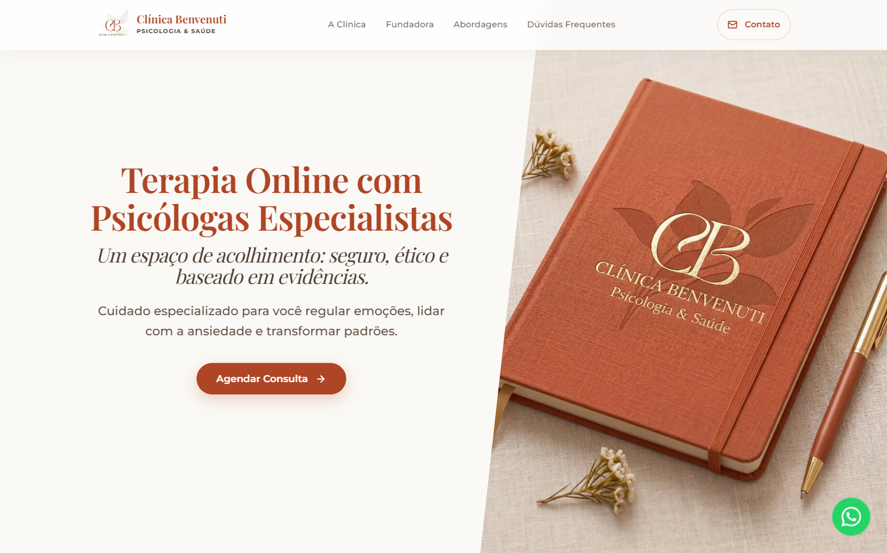
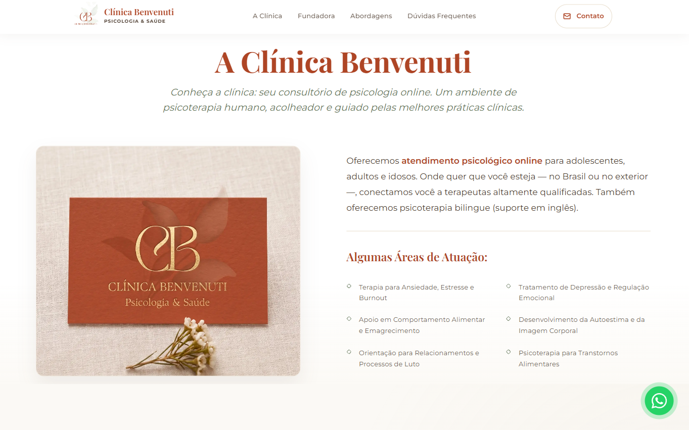
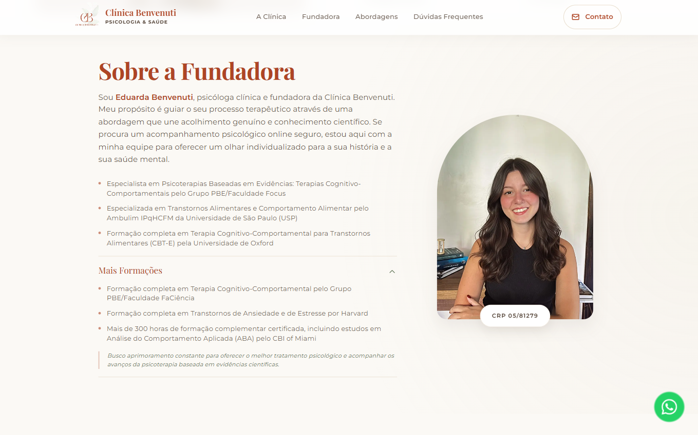
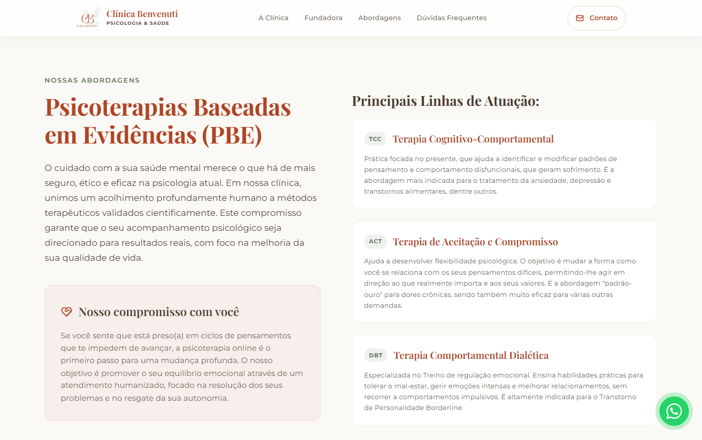
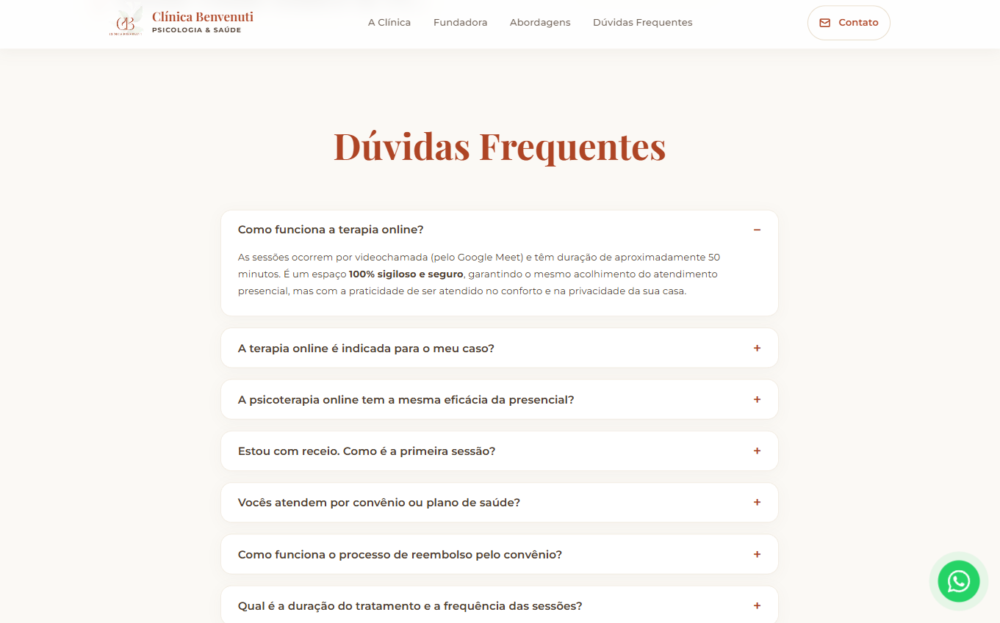
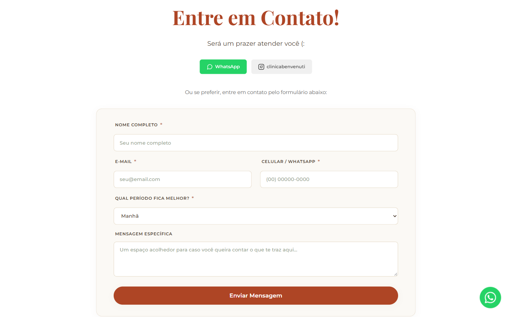

<div align="center">

# 🌿 Clínica Benvenuti — Psicologia & Saúde

**A calm, editorial website for a psychology clinic: it presents the clinical work, the therapeutic approaches and how to book a session.**


[🌐 Live site: clinicabenvenuti.com](https://clinicabenvenuti.com)

</div>



## ⚡ At a glance

- **Real client project**, live in production.
- **Goal:** turn a clinic's presence into a welcoming experience that builds trust and makes it easy to book a first session.
- **Design direction:** clean, editorial layout with fine typography and organic motion, avoiding rigid templates.
- **My role:** UI/UX design and front-end engineering. The clinic's founder provided the content.

## ✨ Sections

| Section | What it does |
|---|---|
| 🌀 **Hero** | Clean introduction with bold typography and a fluid organic shape, highlighting online care available worldwide |
| 🏛️ **The clinic** | Magazine-style presentation of the ethical approach, the target audience and the mental-health topics treated |
| 👩‍⚕️ **Founder profile** | Structured biography with an animated accordion for academic background and certifications |
| 🧠 **Approaches** | Interactive cards explaining CBT, ACT and DBT with smooth hover interactions |
| ❓ **FAQ** | Expandable answers about payments, health plans and session format |
| ✉️ **Contact form** | Validated form that delivers messages by email through the Resend API |

## 📸 Screens

| The clinic | Founder profile |
|---|---|
|  |  |

| Approaches | FAQ |
|---|---|
|  |  |

| Contact form | Mobile |
|---|---|
|  |  |

## 🏗️ Technical highlights

- **Next.js App Router with Server Components** for fast rendering and strong SEO, which matters for a business found through search.
- **SCSS Modules** with variables and responsive mixins, keeping styles scoped and the glassmorphism look consistent, with a 100vh layout per section.
- **Framer Motion** for page transitions, scroll-reveal animations and the organic Hero shape.
- **Contact form handled on the server:** inputs are validated and sent through the **Resend API**, so the API key never reaches the browser.
- **Lucide React** icons that match the typography (Playfair Display for headings).

## 🛠️ Run locally

```bash
git clone https://github.com/larissabenvenuti/[nome-do-repo].git
cd [nome-do-repo]
npm install
npm run dev
```

Create a `.env.local` file:

```env
RESEND_API_KEY=your-resend-api-key
```

Get the key at [resend.com](https://resend.com/) under **API Keys**. Open http://localhost:3000.


## 👩‍💻 Credits

- **Development, front-end engineering & UI/UX:** Larissa Benvenuti
- **Founder, lead psychologist & copywriting:** Eduarda Benvenuti (CRP 05/81279)

## 🔒 Copyright & license

**All rights reserved.**

The source code, interface design, visual architecture and component logic in this repository belong exclusively to **Larissa Benvenuti**. The text content, name, personal images and trademark belong to **Eduarda Benvenuti** and **Clínica Benvenuti — Psicologia & Saúde**.

Reproduction, distribution, modification, public display or commercial use, in whole or in part, without the written permission of the rights holders is strictly prohibited.
